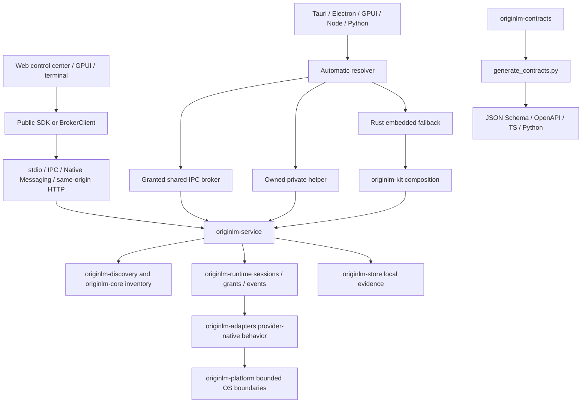

# OriginLM implementation architecture

Current review: 2026-10-28. This section describes implemented boundaries. The
original specification is retained below as historical design, not release evidence.
Current provider qualification and limits are recorded in the [support matrix](../adapters/SUPPORT-MATRIX.md).
OriginLM is the product name; `originlm`, `originlm-*` and `@originlm/*` remain
stable source/package/protocol identifiers (ADR-003).



## Ownership and lifecycle

`originlm` is the Rust automatic facade; `originlm-kit` composes the embedded service.
The CLI owns executable/service lifetimes. SDK imports are inert. Automatic startup
prefers a compatible, already-granted shared broker, then an owned child; Rust can
embed only if allowed and no helper exists. A protocol mismatch is observable as
`FALLBACK_PROTOCOL_MISMATCH`. Grant denial remains fatal. Closing an app releases its
own work; it does not shut down a shared broker or another client's sessions.

Private helpers use a unique local address and parent control channel. Startup failures
and cancellation reap owned children. Service-manager crash recovery is separate from
SDK process ownership. A native control client bounds frames to 1 MiB, bounds its
connect wait and applies a single request deadline, then discards failed streams.
SDK event queues are bounded; gaps are errors to recover from, not silently lost events.

## Authorization and transports

The service is the common contract boundary. Unix sockets/Windows pipes authenticate
with scoped descriptors; private descriptors are one-use. Owner-only regular-file reads
are bounded and validate the opened file. Windows ACL ownership is not inferred from
Unix mode bits. HTTP is loopback, same-origin and explicitly paired. Native Messaging
registration scopes the host to exact extension identities. A website content bridge
and cross-origin loopback/PNA are not implemented. The service installer enables IPC,
not a general HTTP listener.

Discovery, identity metadata, workspace access and execution are separate decisions.
Snapshots retain provider/profile/account/connection/route/model/billing/pool identity
and field-level freshness. No universal token balance or model-effort enum is invented.
Provider terms and native client policies remain in force. See the
[threat model](../security/threat-model.md) and [support matrix](../adapters/SUPPORT-MATRIX.md).

## Data, costs and UI

`originlm-platform` owns platform state-path selection. The kit persists evidence through
`originlm-store`; the desktop uses a separate bounded history under its state directory.
Polling the same observation does not manufacture new samples. Example data is labeled
and separated from real data in both apps. The native mini-view is in-app, not an OS tray.

The runtime observes at most 256 turn-cost records in memory, scoped by application.
`costs.read` prefers documented provider-reported USD charges; otherwise canonical Rust
decimal arithmetic estimates from both token counts and an exact model-price row.
Unknown inputs remain unknown. `costs.setPrices` is administrator-only, validates rows
and atomically saves an owner-only local table when storage is configured. This is not
account-wide spending or a subscription invoice (ADR-005).

The web store owns client state; React views subscribe to slices. GPUI uses background
broker workers and view updates. `selector-core` is framework-free; `react` and `ui-react`
are optional consumers. `brand/tokens.json` generates shared core colors/type for web,
native, site and film. Site/film share one opaque five-screen three.js scene with actual
example UI captures, lazy web loading and a static reduced-motion/no-WebGL fallback.

## Packaging and generated source

Contracts are authored in Rust and regenerated into protocol/SDK artifacts. Never edit
those outputs by hand. Runtime handshake determines method availability; generated
shapes alone do not grant access. Package versions and wire protocol versions are distinct.
The preparation workflow creates unsigned local artifacts for five native targets and
cannot publish (ADR-007). Registry installs, signing and hosted downloads are not claimed.

Decisions: [ADR-002](ADR-002-dependency-first-distribution.md), [ADR-003](ADR-003-v1-product-boundaries.md),
[ADR-004](ADR-004-control-client-and-web-evidence.md), [ADR-005](ADR-005-cost-evidence.md),
[ADR-006](ADR-006-shared-motion-scene.md), [ADR-007](ADR-007-release-preparation.md).

---

## Historical specification (2026-09-24)

# OriginLM — Product and Architecture Specification

**Status:** original design specification (2026-09-24). The implementation follows this design but has diverged in detail; for what exists today see the [support matrix](../adapters/SUPPORT-MATRIX.md).
**Date:** 2026-09-24.
**Working identifier:** `originlm`. This is a development codename, not a claim of npm/PyPI/crates.io, domain, or trademark availability.
**Source attribution:** see [third-party notices](../../THIRD_PARTY_NOTICES.md).

## 1. Product definition

A local-first, language-neutral toolkit that lets an application discover the AI access already configured on a user's computer, understand what it can actually do, display accurate account/plan/usage/model information, and communicate with supported local agents or explicitly configured APIs through one stable interface.

The developer experience should be: **connect once, inspect once, select a usable route, run a session**. Applications should not need to know credential paths, operating-system keyring APIs, provider-specific quota formats, CLI flags, model-option spellings, or streaming event dialects.

This is a developer toolkit with an optional shared local runtime, SDKs, and reusable UI. It is not a new subscription service, a hosted credential proxy, a full IDE, or a consumer application tied to a specific use case.

### The promise we can keep

Discover **locally installed/configured integrations and the access they can verify**. The toolkit cannot discover every subscription a person owns merely from an installed executable, a browser login, an email address, or an expired credential. Unsupported/unknown information must remain explicit. Broad adapter coverage is a continuing maintenance program, not an excuse to manufacture complete-looking data.

### Success criteria

A developer can use Rust, TypeScript, Python, or any language with local-process/HTTP support; obtain useful results without creating an account with us; embed only discovery or opt into execution; and add a new provider without changing every SDK or UI component. The demo must exercise the published public interface rather than bypassing it through private application code.

## 2. Product boundaries and staged deliverables

The first release family has five independently useful pieces:

1. **Discovery and metadata:** installations, profiles, authentication evidence, plans, catalogs, capabilities, usage, health, and local activity.
2. **Execution runtime:** explicit session creation, streamed turns, configuration, cancellation, approvals, and supported native session resumption.
3. **Interfaces:** Rust crate, CLI, JSON-RPC over stdio, optional local HTTP/SSE, TypeScript SDK, Python SDK, OpenAPI/schema artifacts.
4. **Selection/UI toolkit:** framework-neutral selection logic; optional React bindings and styled components.
5. **Local demo and developer tooling:** selector gallery, account/capability/usage explorer, session playground, diagnostics, and contributor conformance tests.

Do not make discovery depend on React, Tauri, Electron, a web server, or starting an AI agent. Do not make the UI depend on a particular provider. Do not make a normal scan consume model inference quota.

### Explicitly outside the first release

Hosted multi-user inference brokerage; resale/pooling of subscription access; unattended account switching to evade limits; browser-cookie scraping; a general credential vault for other apps; billing management or purchasing credits; a full IDE/terminal; a provider marketplace that executes arbitrary downloaded code; transparent cross-provider migration of native sessions; mandatory telemetry; generic media pipelines; and a single global “AI tokens remaining” counter.

Later additive work can include more SDKs, desktop wrapper examples, a narrowly scoped MCP bridge, optional compatibility adapters, and a signed adapter distribution channel. None is a prerequisite for a useful first release.

## 3. Architecture decision

**Use a Rust core and a protocol-first interface.** Thin language wrappers all call the same implementation. Do not separately reimplement discovery in TypeScript, Python, Swift, C#, and Go.

```text
Host apps: desktop / CLI / local web UI / browser extension / backend worker
          | Rust crate | TS/Python SDK | stdio JSON-RPC | local HTTP/SSE
          v
OriginLM service interface
  discovery + evidence + account identity + model/catalog + quota + selection
          |
          +-- discovery-only mode (no execution runtime required)
          +-- execution module (explicit grants, sessions, approvals, events)
          |
Adapter registry + shared process/network/credential abstractions
          |
Codex app-server | ACP clients | native JSON CLI | OpenCode HTTP | local APIs
```

### Deployment modes

**Embedded Rust:** the host links the core and selects compiled adapter features. No daemon needed. This mode shares work only within that host; do not claim automatic cross-application deduplication.

**Managed sidecar:** a JS/Python/other app launches a native binary over stdio. No Rust toolchain is required for end users. The app owns this sidecar's lifetime. Protocol negotiation protects clients from mismatched binaries.

**Shared per-user broker:** apps explicitly connect to one authenticated local process. It deduplicates scans, provider metadata probes, and quota requests across those clients. Unix-domain sockets or Windows named pipes are the preferred native local endpoint; app-session authorization remains separate. One app closing must not terminate another app's active work.

**Local HTTP:** an opt-in loopback facade for the demo, generic clients, and integration examples. No public/LAN binding by default. The demo is served from this same local origin, avoiding a requirement that a hosted webpage can silently access localhost.

**Browser extension:** optional Native Messaging host connected to the same services. A native host installation is still required. A plain website or browser SDK cannot directly inspect the user's filesystem/keyring. A remote backend sees its own host unless the user explicitly connects an authorized local helper; no remote relay ships by default.

### Stack

Rust stable/edition 2024, Tokio, Serde, a typed schema-generation toolchain, an HTTP framework with SSE support, OS-native credential access behind traits, and a small CLI framework. The implementation audit selects and locks exact compatible versions. Frontend: TypeScript, React, Vite, optional shadcn-style components/accessibility primitives, CSS custom-property theming. Test tooling: Rust unit/integration tests, Vitest, Playwright, Python pytest, generated-contract checks, and platform CI.

A provider that only exposes a usable JavaScript SDK can use a separately packaged, lazy Node worker. This is an explicit adapter dependency, not an unconditional Node runtime requirement for the Rust package. Prefer native CLI/protocol routes when they preserve the required functionality.

## 4. Repository and distribution layout

```text
crates/
  originlm-contracts/       domain records, wire types, errors, schema generation
  originlm-core/            registry, identity, snapshots, capability resolution
  originlm-platform/        paths, keyrings, bounded readers, process/network abstractions
  originlm-discovery/       staged scans, watchers, caches, probe scheduling
  originlm-runtime/         grants, sessions, turns, approvals, artifacts, cancellation
  originlm-adapters/        adapters/<name>/{detect,metadata,execute,parse,tests}
  originlm-service/         one service implementation used by every transport
  originlm-cli/             scan, doctor, serve, demo, explicit account setup
  originlm-transports/      stdio, local socket/pipe, HTTP/SSE, native-message bridge
packages/
  sdk-typescript/     generated types + ergonomic client + transport adapters
  sdk-python/         generated models + sync/async client + streaming helpers
  selector-core/      pure selection/filter/group/favorite state; no DOM or I/O
  react/              hooks and accessible headless bindings
  ui-react/           optional styled selectors/panels, explicit CSS import
apps/
  demo/               public-SDK-only live demo + clearly labeled fixture mode
examples/
  node/ python/ rust/ vanilla-web/ dotnet-http/ tauri/ browser-extension/
protocol/             generated JSON Schemas, OpenAPI, JSON-RPC method manifest
fixtures/             synthetic provider payloads, fake CLIs, virtual homes
scripts/              verification, generation, package smoke checks, benchmarks
.support/             generated adapter support evidence, not credentials
docs/
  architecture/ adapters/ integration/ security/ performance/ handoffs/
```

The Rust contracts crate is the authoring source of public domain types. Generated schemas, SDK models, and API specifications must be reproducible and checked for drift. Avoid independently hand-maintained versions of the same interface. Separate wire protocol version from package and adapter versions.

Publishable names are selected only after availability review. Suggested package structure is conceptual, not a statement that these names exist: one small JS client, one optional platform-binary installer package, Python bindings, Rust crates, and independent UI packages. Importing a package must not scan, spawn, contact providers, download binaries, or read credentials.

## 5. Data model: identity and access routes

Do not use one `Provider` record to represent a company, CLI, account, model author, gateway, and billing source.

| Record | Meaning |
|---|---|
| Provider | The service/model vendor or gateway identity. |
| Installation | A located executable/runtime/editor installation, version evidence, platform and environment. |
| Profile | One client configuration/home/workspace context. |
| Account | A provider-reported principal/workspace where available; masked UI identity. |
| Connection | An installation/profile plus its actual configured authentication context. |
| AccessRoute | An executable path through a connection to a service/model; billing and policy context included. |
| Model | Native model ID and metadata as exposed by that route; optional separately evidenced canonical alias. |
| Capability | A reported/verified/conditional feature at model, tool, runtime, transport, or route scope. |
| OptionDescriptor | The provider's model/session/turn controls and valid native values. |
| Entitlement | Reported plan/service access with provenance; not inferred from installation alone. |
| QuotaPool | A metered resource that multiple routes may share. |
| UsageWindow | The unit, current reading, reset and scope of a quota or rate window. |
| Session/Turn | Broker-owned mapping to a native agent or direct-API conversation. |
| Artifact | A scoped result attachment, independent of a particular media use case. |

A model key is route-scoped. The same model name reached through a work account, personal subscription, direct API, or gateway is not the same selectable/billable route. Use opaque stable IDs; never expose an ID derived directly from a secret. Stable account linking needs provider subject/workspace evidence, not email alone. A parsed token claim is not automatically a verified identity.

Separate **UI grouping** from **execution identity**. A provider rail may group related routes, but selection always preserves `routeId`, `connectionId`, account context, native `modelId`, and option values.

## 6. Evidence and truthful unknowns

Attach provenance and freshness to fields, not just to the entire account. A live model catalog can coexist with stale quota data and an unknown plan.

```ts
// Proposed public shape; generated from the Rust contracts at implementation time.
type EvidenceSource = {
  kind: "official_protocol" | "official_api" | "local_config" |
        "local_log" | "community_endpoint" | "user_supplied" | "derived";
  adapterId: string;
  adapterVersion: string;
  clientVersion?: string;
  reference?: string;
};

type Observation<T> =
  | { state: "known"; value: T; source: EvidenceSource;
      observedAt: string; freshness: "fresh" | "stale";
      expiresAt?: string; verification: "reported" | "observed" | "inferred" }
  | { state: "unknown" | "unavailable"; reason: string; checkedAt?: string };

type Capability = {
  id: string;
  support: "supported" | "unsupported" | "conditional" | "unknown";
  origin: "model" | "agent_tool" | "runtime" | "transport";
  evidence: Observation<string>;
  conditions: string[];
};
```

The exact schema should use typed reason codes as well as readable messages. Reference/source strings must not contain credentials, full private paths, or unrestricted raw provider bodies. Store repeated evidence in a source table if needed to avoid payload bloat.

Important distinctions: unsupported is not unknown; expired is not absent; cached is not fresh; quota is not spend; recent file modification is not proof that an agent is currently generating; model input support is not output-generation support; detection does not imply permission to execute.

A newer authentication failure must remain visible even when old usage is displayed. On account/workspace/auth-source changes, invalidate account-scoped catalogs, quotas, and permissions before showing results for the new identity.

## 7. Discovery pipeline

### Tier 0: passive local inventory

Read allowlisted executable locations, configuration metadata, and permitted environment variable names. Check the current user's supported profile roots. Recognize legitimate native/package-manager shims and custom paths. Do not execute binaries, unlock credential stores, inspect browser cookies, read arbitrary projects, scan every disk, or contact the internet.

Report installation/configuration signals immediately. A credential-file presence signal may produce `auth=unchecked`, not `authenticated`.

### Tier 1: authorized local metadata

With application/user grants, read bounded credential metadata, official local status/log records, and editor databases opened read-only. Respect client-specific home overrides, XDG directories, Windows paths, macOS app/keychain conventions, and independent work profiles. Use known schemas and redact before any data leaves the adapter boundary.

Locked keyrings, inaccessible files, absent Secret Service, or malformed local state produce field-level unavailable states. Never repeatedly prompt to unlock keychains during a periodic scan.

### Tier 2: authorized client/protocol probes

Initialize approved installed clients or call their supported local metadata interfaces. Negotiate version/capabilities; retrieve available accounts, models/options, and usage where the interface supports it. Start in an isolated neutral working directory. Do not execute project hooks/MCP servers during a supposedly passive check; mark adapters that cannot avoid startup side effects as requiring explicit runtime-probe consent.

Discovery must not send generation prompts. Do not open a fresh session for every UI render. If metadata requires session setup, classify that action explicitly, acquire consent, reuse/cache appropriately, and do not claim it is an inert filesystem scan.

### Tier 3: authorized network enrichment

Query supported provider account/usage/catalog endpoints when allowed. Prefer official client-reported data. Undocumented/community endpoints are a separate opt-in support tier with versioned parsers and an explicit risk label. Do not ship client impersonation, token transplantation, or an undocumented private endpoint as a default universal authentication mechanism.

Every stage streams partial results and has its own timeout/cancellation. Enrich slow fields later; do not hold all providers behind the slowest one.

### Environment boundaries

Windows and WSL installations are distinct execution environments. WSL discovery is opt-in and must not automatically start stopped distributions. A path found inside WSL must run in that same distribution. Containers/remote hosts require explicit registration; no silent SSH probing. Cross-profile working directories and account labels remain distinct.

## 8. Models, capabilities, and native option descriptors

Catalog preference order: live authenticated client catalog; official provider catalog filtered by known route/account eligibility; clearly stale last-good catalog; versioned documented metadata marked unverified for that route. A hard-coded marketing list is never proof that the account can use a model.

A canonical model alias is optional presentation metadata. Never strip a thinking-level suffix or rewrite a native ID before execution without an adapter-defined, tested mapping.

### Descriptor-driven controls

Support `select`, `boolean`, and bounded numeric/text controls in the toolkit's own schema. An adapter advertises only types its upstream protocol supports. Each descriptor includes native ID, semantic category, label/help, valid values, current/default state, scope, dependencies, change timing, source, and possible billing effects.

Categories can include model, thought level, service tier, context, output budget, mode, and permissions. They are presentation hints, not wire-method names. Unknown categories remain displayable. Unknown option types remain inspectable but noneditable until supported.

Never assume every model has Low/Medium/High. Preserve native choices, including models where thinking is encoded in the model ID, where an effort control is absent, or where the option changes after model selection. Do not invent numeric equivalence across providers. Provider modes that weaken permissions require an explicit permission grant even if represented as a simple boolean.

Validate selections locally and again against the current route descriptor revision immediately before a turn. If changing a model invalidates an effort, clear/reconcile it visibly rather than silently coercing to an expensive setting. Session-scoped settings must not mutate another user's session or the provider's global config.

### Effective eligibility

Separate supported features from usable-now status. Evaluate the selected model or enabled tool, connection authentication, account/service access, runtime/transport capability, workspace requirements, granted permissions, and known blocking limits. Unknown critical evidence returns a reasoned unresolved result; it does not become true.

A tool-mediated ability must be labeled as such. The toolkit should not attribute a tool's functionality to the base model. Delegated tools also retain their own credentials, permissions, and billing identities.

## 9. Plans, usage, quota pools, and costs

Preserve provider-native plan IDs and reported labels. Normalize broad billing categories (`subscription`, `api_metered`, `prepaid_credits`, `local`, `mixed`, `unknown`) without fabricating a universal hierarchy.

A usage record includes pool ID, account/workspace scope, product/model scope, unit, observed value, optional limit/remaining value, optional fractional percentage, window type/duration, reset timestamp, freshness, and source. Large integer counts and monetary decimals must round-trip without JS precision loss. Counter units are explicit.

Do not infer token counts from percentages or request counts from token usage. An unknown denominator yields a count without a percentage gauge. Percent remaining is derivable only from a known comparable total/used reading; mark it derived. A rate window and a monthly balance are not additive.

Quota pools are first-class. If two connections demonstrably consume the same provider account bucket, show one pool and its linked routes. If sharing cannot be established, show `sharing=unknown`; do not confidently sum them. Deduplicate refreshes by verified pool identity.

Separate this toolkit's measured session usage from the provider's total account usage. External applications can consume the same allowance. Forecasts are optional estimates with a method and confidence, never guaranteed remaining turns.

Price metadata has currency, unit, source, and date. Subscription access is labeled **included allowance**, not free. No automatic API fallback, credit purchase, reset-credit redemption, or paid service-tier upgrade. Selection preferences can favor an included route, but the runtime still needs explicit billing authorization. Hard monetary guarantees cannot be promised for opaque subscription billing or delayed provider accounting.

## 10. Client communication and execution engine

### Adapter integration priorities

Use Codex app-server for its native protocol; a shared ACP client implementation for compatible agents; native supported JSON/streaming CLI modes where needed; OpenCode's HTTP interface; and official local/direct APIs. Prefer upstream-maintained protocols over terminal scraping. SDK workers are optional adapters, not the universal runtime.

The driver surface has discovery/metadata methods independent of execution methods. Each adapter publishes a feature matrix and a verified client-version range. Unknown future versions can provide passive detection while execution fails closed with an actionable compatibility message.

### Session lifecycle

`create -> ready -> running -> awaiting_approval -> running -> completed/error/cancelled -> closed`.

Create sessions lazily, pin each to its route/account/environment/workspace and permissions, validate option revisions, stream results, and support cancel/close. Resume only when the same native provider route can genuinely load the session. Importing a transcript elsewhere is a separate future operation, not transparent native resumption.

Existing running clients may be attached to only via a supported, authorized interface. Do not read process memory, hijack terminals, or kill user-owned sessions. Track broker-owned child processes and terminate only those. Windows process-tree cleanup must use suitable job/process handling; Unix cleanup must account for descendant processes.

### Normalized events

Events carry a session/turn ID, monotonic sequence, timestamp, adapter ID, and schema version. Types include session state, text delta, provider-supplied reasoning summary where exposed, tool call/update/result, approval request/resolution, option/catalog update, artifact, usage, warning, error, and final result.

No invented private reasoning traces. Preserve meaningful provider differences in a bounded, sanitized, namespaced extension object. Common SDKs must not require consumers to parse native provider JSON.

Ordering and backpressure are correctness features. Never silently drop output text, approvals, or final results. Coalesce redundant progress/usage events. If an adapter cannot be slowed and buffers fill, fail/cancel explicitly rather than consume unlimited memory. Reconnect uses a bounded replay window and an explicit event-gap response; replaying events must never rerun a turn.

Do not retry a turn automatically after output, tool execution, or an ambiguous disconnect: duplicate side effects and charges are possible. Retry metadata reads only under a bounded policy. Cancellation or tool denial must not trigger another account/provider automatically.

## 11. Public protocol and SDK

The version-one protocol exposes these families, with the same domain types across transports:

| Family | Methods |
|---|---|
| Runtime | `runtime.handshake`, `runtime.health`, `runtime.closeClient` |
| Discovery | `discovery.refresh`, `discovery.cancel`, `snapshot.get` |
| Accounts/data | `connections.list`, `models.list`, `usage.read`, `capabilities.read` |
| Selection | `selection.resolve`, `selection.validate` |
| Authorization | `grants.request`, `grants.list`, `grants.revoke` |
| Setup | `connections.setupInstructions`, `connections.authenticate` (explicit action) |
| Sessions | `sessions.create`, `sessions.get`, `sessions.updateOptions`, `sessions.close` |
| Turns | `turns.start`, `turns.cancel` |
| Approvals | `approvals.respond` |
| Results/events | `artifacts.read`, `events.subscribe`, `events.unsubscribe` |
| Diagnostics | `diagnostics.report`, `adapters.list` |

All callers receive only grant-authorized data. Filtering happens at the service boundary, not only in the UI. Paginate catalogs/results; provide field projections and delta updates. The initial `snapshot.get` returns cached/current data without silently triggering network activity.

**Stdio:** newline-delimited JSON-RPC 2.0, UTF-8, strict frame/body limits, stdout reserved for protocol and stderr for redacted logs. Unknown methods return the standard error envelope plus typed domain details. Capabilities negotiate optional methods.

**HTTP:** versioned REST facade, generated OpenAPI, authenticated SSE stream. Common paths include `/v1/snapshot`, `/v1/connections`, `/v1/models`, `/v1/usage`, `/v1/selections/resolve`, `/v1/sessions`, `/v1/turns`, `/v1/events`, `/v1/diagnostics`. Operation IDs map to the service methods. State-changing work is never a GET.

**Native sockets/pipes:** same protocol over a framed local transport with OS-user permissions. **Native Messaging:** translation layer with its own framing and tested message-size constraints; large artifacts use scoped streaming/chunks, not arbitrary file paths.

### Proposed TypeScript experience

```ts
import { createLocalAI } from "originlm"; // proposed package name

const ai = await createLocalAI({ transport: "managed-stdio" });
try {
  await ai.discovery.refresh({ level: "passive" });
  const snapshot = await ai.snapshot.get();
  // Render detected connections; application requests grants before enrichment/run.
  const candidates = await ai.selection.resolve({
    requiredCapabilities: ["generation.text"],
    billingPreference: "prefer-included",
    allowPaidFallback: false,
  });
  // Display candidates and their explanations. Do not auto-run the first row.
  console.log(snapshot.revision, candidates);
} finally {
  await ai.close();
}
```

Every SDK supports timeouts, cancellation, typed errors, async event iteration, and protocol-version checks. Python provides async-first and a thin sync facade. Rust uses the same service interfaces in process. C#/Go/other users have complete HTTP/stdio documentation and tested minimal examples without needing a custom native binding.

Representative typed errors: `LOCAL_ACCESS_DENIED`, `AUTH_REQUIRED`, `KEYRING_LOCKED`, `RUNTIME_MISSING`, `INTEGRATION_RESTRICTED`, `PROTOCOL_INCOMPATIBLE`, `CAPABILITY_UNKNOWN`, `CAPABILITY_UNSUPPORTED`, `OPTION_UNSUPPORTED`, `SELECTION_STALE`, `RATE_LIMITED`, `BILLING_CONSENT_REQUIRED`, `APPROVAL_REQUIRED`, `SESSION_ROUTE_MISMATCH`, `EVENT_GAP`, and `PROVIDER_UNAVAILABLE`.

## 12. Authorization and security boundaries

Discovery permission is not permission to consume an account. The broker issues per-client, revocable grants scoped to metadata, account identity, usage, models, specific connections, execution, workspace roots, network/tool access, and artifact access. Mask identities until that client has identity permission.

Prefer official client-managed sign-ins. A third-party application's authentication token is not automatically a portable API credential. Direct API keys are explicitly supplied/imported with permission, stored in an OS credential store where available, and passed only to their approved endpoint. Never return raw provider tokens to SDK consumers, browser scripts, or demo JSON inspectors.

The account's installed client owns refresh where possible. Do not race it by rewriting its credential files. A read-only parser must not become an unrestricted token-export endpoint. Private/community metadata mechanisms require an adapter-specific policy decision and visible classification.

The HTTP bridge binds loopback, checks Host/Origin, requires authentication and per-client grants, rejects wildcard CORS, and has explicit pairing. CORS alone is not authentication. Use short-lived single-use pairing codes approved by the user; no long-lived secrets in URLs, command arguments, analytics, or logs. A hosted demo cannot auto-pair. The default live demo is served by the local runtime.

Agent execution has explicit working directories, tool policy, environment allowlists, argument arrays instead of shell-interpolated user text, timeouts, concurrency limits, and cancelable child lifetimes. Verify symlinks/path containment at actual I/O operations, not only by string prefix. Distinguish requested constraints from guarantees the native client can enforce; reject a task requiring an unenforceable constraint rather than claim sandboxing.

Process isolation limits crashes; it is not a security sandbox for malicious plugins. Initial adapters are reviewed first-party code. Future external adapters need declared permissions and real OS isolation or an explicit trusted-code installation policy. Do not hand unknown plugins reusable credentials by default.

All caches and diagnostics are schema-filtered and redacted before serialization. No prompt/output persistence by default; opt-in session history is separately scoped. Temporary artifacts have ownership checks, expiration, byte limits, and safe deletion. Retain no arbitrary user-provided path in artifact URLs.

Threat-model limits must be stated: the package is not a defense against malware already fully controlling the user's OS account. Browser-origin protections, app grants, and user identity on IPC still matter and must be tested.

## 13. Optimization strategy and measurable budgets

These are **initial engineering targets**, not measured results. Record hardware, OS, build, fixture size, cold/warm state, and dependencies for every measurement.

| Measurement | Initial target / condition |
|---|---|
| Warm snapshot read | p95 <= 20 ms in-process; <= 50 ms over local transport. |
| Passive cold inventory | p95 <= 1 second for 20 registered adapters/10 profiles on the documented SSD reference host; excludes network and agent startup. |
| Idle native runtime | <= 50 MiB RSS and <1% of one logical CPU averaged over 60 seconds with no active agent; report platform differences. |
| File-change handling | Cached field invalidation and local change publication within 500 ms after debounce under fixture load. |
| Large-log refresh | Reads proportional to appended/changed bytes; never rescan a 1 GiB log per refresh. |
| Browser SDK footprint | Target <= 25 KiB gzip excluding optional UI and native distribution. |
| Provider isolation | A hung provider cannot delay cached snapshot reads or other provider updates. |
| Repeated requests | One in-flight metadata request per connection/pool key per broker; no observer-driven stampede. |

Use bounded concurrency, file watchers with debounce, incremental JSONL tails, file identity/rotation detection, selective read-only SQLite queries, per-field TTLs, negative caching, a shared network client, provider Retry-After/backoff with jitter, and immutable/versioned snapshots. No fixed rapid polling loop across every provider. No scans triggered by a React render. Cancel unnecessary refresh work when subscribers disappear.

Start with conservative scheduling defaults (for example, six local reads, two metadata child probes, and two network calls per host), make them configurable, and benchmark rather than treat those constants as universal optimums. Loaded agent processes, model inference memory, and the optional browser UI are measured separately from the broker.

Selection operates on an indexed catalog and updates only affected entries. Virtualize large model lists; preserve stable route keys and focus. Core imports remain side-effect-free and UI dependencies remain optional. Avoid prematurely adding a database service, message broker, mandatory telemetry SDK, or multiple competing internal state stores.

## 14. Demo application and selector gallery

The demo is both the product showroom and the integration acceptance test. It imports released-workspace SDK/UI packages and uses only public APIs. A developer can launch a local live demo; a separately labeled synthetic mode showcases unsupported/missing-account states without paid accounts. No fixture account may ever appear as a detected live account.

### Demo workspaces

**Overview:** discovered installations/connections, usable routes, auth problems, detection timing, broker health, and evidence freshness. No combined fictitious allowance.

**Connections:** provider -> installation/profile -> account -> route; masked identity, exact plan evidence, billing mode, linked quota pools, permitted actions, setup instructions, and revoke controls.

**Model/capability explorer:** searchable route-scoped catalogs; input/output types, context/output bounds where known, tool versus native capabilities, option descriptors, defaults, restrictions, sources, and last checked time.

**Usage:** per-pool windows, resets, credits/cost units, route sharing, stale/unknown states, toolkit-session usage versus provider account totals. Display counts without arcs when totals are unknown.

**Selector Lab:** eight selectors below, all sharing the same selection engine and grant-filtered catalog. Each has live preview, props/configuration, accessible interaction notes, and a copyable integration example that contains no secrets.

**Session Playground:** choose route/model/options, inspect billing/workspace/permission preflight, explicitly start a small text task, observe streaming events, answer/deny approvals, cancel, inspect usage/artifacts, and resume only where supported. No invocation occurs on page load.

**Diagnostics/API Explorer:** redacted normalized records, field evidence, adapter certification, local probe timings, protocol event timeline, and safe public method examples. Explicitly gated operations remain gated here; an API explorer must not bypass security.

### Eight selector variants

1. **Provider rail (default, T3/Prmptr-inspired):** vertical provider/connection list on the left, searchable model list centrally, selected model/options details to the right or below. Expand a provider into personal/work connections without conflating them. Favorites and recents retain route identity.
2. **Compact grouped combobox:** a small composer-friendly popover with provider sections, clear route/account badges, and an adjacent dynamic effort control.
3. **Command palette:** keyboard-first global search over provider, model, account label, capabilities, and native IDs. Show why an entry is unavailable and a setup action outside the selection list.
4. **Capability-first selector:** users select requirements such as structured output, tool support, offline operation, or resumable sessions; show matching routes and explanations for excluded ones.
5. **Comparison table:** compare model/routes, context, features, billing sources, and quota freshness. Sort only on comparable known metrics; unknown values stay unknown.
6. **Allowance-aware route picker:** group included-subscription, metered API, and local routes; show pool sharing and blocking windows. Never rank unlike percentages as interchangeable capacity.
7. **Task/preset picker:** user/app-defined requirements presets choose compatible configurations, not an LLM-generated assertion that one model is universally best. Preview exact selected route and options before execution.
8. **Mobile drill-down sheet:** provider -> account/route -> model -> native options; preserves selection and back navigation on narrow screens.

The provider-rail variant is an acceptance requirement, not an optional cosmetic extra. Port Prmptr's interaction idea and T3's account-instance separation, not their host-app state stores.

### Shared UI behavior

Dynamic options come from descriptors. New providers need no hard-coded UI branch. Expose tokens/CSS variables, light/dark/high-contrast themes, density, render slots, controlled/uncontrolled selection, optional icon packs, and replaceable persistence. Package the filtering/grouping/state machine without React for other frameworks.

Keyboard and screen-reader support are required. Use established accessible primitives and avoid nested interactive controls inside listbox options. Give favoriting an accessible separate action/toolbar when necessary. Preserve the active option under virtualization; provider/model updates must not steal focus. Test small windows, long names, multiple accounts, 5,000 models, disabled selections, stale catalogs, option changes, reduced motion, and high contrast.

Synthetic mode includes an expired login, locked keyring, unknown plan, unknown quota denominator, two routes sharing one pool, duplicate model IDs across accounts, a future unknown effort value, a provider outage, and a permission-denied tool request. A public static demo never reads the visitor's computer automatically.

## 15. Provider rollout and honest support matrix

Track **detection, auth evidence, plan, usage, catalog, options, text sessions, tools/approvals, cancellation, resumption, and platform coverage separately**. No single green “supported” flag can stand in for all of them.

| Release group | Integrations | Required approach |
|---|---|---|
| Reference vertical slice | Codex | Official app-server plus account-scoped evidence; exercise discovery -> selection -> streamed turn -> cancel/approval. |
| ACP and gateway tranche | Antigravity, Grok, OpenCode | Shared ACP engine where actually supported; OpenCode official HTTP server; exact installed versions qualified. |
| Native-client and local-runtime tranche | Claude Code, Gemini CLI, Cursor client where supported, Ollama, LM Studio | Native documented client/API routes; Google clients remain distinct. Models/usage depend on what each route exposes. |
| Explicit API routes | OpenAI, Anthropic, Gemini, xAI, and a configurable compatible endpoint | User-authorized keys, explicit billing, native catalog/stream semantics. “Compatible” means a tested subset, not universal feature parity. |
| Subsequent adapters | Copilot, Kimi, Kiro, Amp, Z.ai/GLM, MiniMax, DeepSeek, other sources in CodeNotch | One evidence-backed adapter contribution at a time using the same conformance suite. |

The target v1 includes adapters for the named first three tranches and explicit API routes, but release evidence determines each operation's status. Do not certify untested live accounts. Missing accounts on the developer machine do not block fixture-based development of the adapters; record `not_live_tested` rather than pass. A provider whose sanctioned execution path cannot be established can ship passive detection with execution explicitly unavailable, without being mislabeled fully supported.

## 16. Testing, support, and release gates

Tests must require no personal subscriptions by default. Use virtual homes, credential-store mocks, fake executable shims, local protocol servers, synthetic JSONL logs, frozen clocks, and injected HTTP clients. Test malformed/truncated files, token rotation, locked stores, account changes, custom home paths, duplicate installations, stale data, 429 responses, unknown options, stream disconnects, process-tree cleanup, and revoked grants.

Run contracts and adapter fixtures across Windows, macOS, and Linux. Initial release binaries target Windows x64, macOS arm64/x64, and Linux x64/arm64 with documented libc baselines. Windows arm64 can be a separately qualified target; do not advertise it from a successful cross-compile alone. State minimum supported OS/runtime versions after checking dependencies and executing clean-machine smoke tests.

Live tests are opt-in, explicitly authorized, low-cost, and separately reported with platform, client version, auth mode, test name, and date. No CI workflow automatically spends a contributor's quota. Fixture success, compile success, and live success are different evidence levels.

Security tests cover origin/Host rejection, grant scoping/revocation, secret redaction, arbitrary-path access, command injection, symlink escapes, malicious provider responses, malformed frames, and approval denial. A reused source's security posture is not inherited automatically.

Release gates: reproducible generated contracts; passing unit/contract/SDK/UI tests; platform packaging smoke checks; a genuine Codex or other authorized reference live route where available; no unmarked fixture behavior; public support matrix; benchmark reports; dependency/license/SBOM review; redacted diagnostic bundle; and documented limitations. Registry publication and signing require owner credentials/approval and are not implied by this handoff.

## 17. Maintenance and differentiation

The durable value is consistent account/route identity, truthful metadata, provider-maintenance knowledge, and stable integration surfaces—not another thin text-generation wrapper. Maintain an adapter kit, synthetic record/replay fixtures, protocol-change diagnostics, compatibility ranges, and field-level evidence. Community contributions must include tests and source/licensing notes.

A supported registry should explain what changed when a provider integration breaks. Initial updates ship through normal package releases with lockfiles; no silent executable downloads. A future signed capability-metadata feed can update documented labels without automatically granting new execution paths.

## 18. Definition of done for the first release candidate

A clean install can launch the local demo, choose fixture mode without accounts or explicitly authorize live discovery, view evidence-backed data, use every selector variant, and execute/cancel an authorized supported session through the public SDK. TypeScript, Python, Rust, and a plain HTTP example all access the same service without duplicating provider logic. Authentication changes cannot leak another account's metadata; shared pools cannot be counted twice; model controls cannot advertise unsupported values; cached results cannot conceal current access failures; and unverified providers/platforms are visibly unverified.

The implementation plan sequences this work into testable increments. Completion is based on evidence per operation and platform, not the number of provider logos in the demo.
