# Landing page: audit and rebuild log

## 2026-11-04, second pass: "the eye wakes" (current)

The owner rejected the first pass below as underwhelming and generic. The visual
direction was started over; copy, product facts, the quickstart, the samples, the
section order (developer tooling first, usage lower) and the amber brand were kept.
Plan, palette, type and the critique against the banned list:
[`landing-wow-plan.md`](landing-wow-plan.md). Frames: before
[`screens/wow/before/`](screens/wow/before/), first build
[`screens/wow/pass1-first-build/`](screens/wow/pass1-first-build/), mid-review
[`screens/wow/pass2-mid/`](screens/wow/pass2-mid/), final
[`screens/wow/after/`](screens/wow/after/), reduced motion
[`screens/wow/reduced/`](screens/wow/reduced/), and a 17s scroll-through
[`screens/wow/scroll-through.webm`](screens/wow/scroll-through.webm).

What changed from the first pass:

| Area | First pass | Now |
| --- | --- | --- |
| Hero | Headline plus an interactive trace panel | 8.6vw Fraunces headline rising out of masks; a WebGL scene behind it in which the logo, as an eye, wakes, tracks the pointer, and finds five clients |
| How it works | A system diagram and the trace in the hero | One pinned, scrubbed story (Discover, Select, Grant, Run) that morphs the same scene and the same snapshot table; the quickstart types itself |
| Architecture | Five boxes | The camera pulls back to one machine outline; provider-bound lines leave it, Ollama's stays; "Nothing passes through an OriginLM server, because there isn't one" as the largest type on the page; the five-step path follows as HTML |
| Lower sections | Same head-split on every section | Restyled per section on unlit ground with grain; an amber margin thread ignites a node per section |
| Close | Footer CTA | The scene returns; the eye blinks once and looks at the install command |
| Removed | `Trace.tsx` (its data moved to `src/data/story.ts`), the old hero layout | |

The deleted 3D attempt (an exploded five-panel screenshot stack, three.js with bloom and
bokeh, recovered from T3 checkpoint `f1924d3`) was not restored: its concept (panels of
screenshots) is not this one, and it depended on screenshot textures that no longer
exist. Kept from it: the WebGL2 and software-renderer probe, the light tier, the error
fallback to stills, and the visibility gating. three.js itself was dropped for a 10.5 KB
raw WebGL2 module; see the plan.

Measured on the final build (`scripts/measure_perf.mjs`, headless Chrome, 1440×900):
initial JS 95.1 KB gzip (React 68.5, app 26.6), CSS 10.0 KB; lazy chunks: scene 10.5 KB,
director (GSAP, ScrollTrigger, Lenis) 51.1 KB; fonts 72 + 41 + 21 KB. LCP 0.33 s, CLS 0,
TBT 81 ms; at 4× CPU throttle LCP 0.73 s, TBT 257 ms. Frame rate on this machine's GPU
(an RTX 3080, far above a mid-range laptop) with 4× CPU throttle: 141 fps idle, 148 fps
while scrubbing (p95 12 ms). On SwiftShader (software, the floor): 32 fps idle, 31 fps
scrubbing. No real mid-range laptop was measured.

Checks: `npm run build` (tsc, Vite, prerender) passes; `scripts/test_site.mjs` 9/9;
`npm run check:samples` (TypeScript samples compile, negative control fails);
`npm run check:contrast` 47/47. Python and Rust samples are unchanged since the table
below and were not re-run.

The rest of this document is the first pass's audit, kept for its findings and
measurements.

---

Scope: `apps/site` (React 19, Vite 8, prerendered). Audited state: the working
tree on 2026-11-04 before this pass, which already included an uncommitted
"terminal register" experiment (`styles/terminal.css`, `UsagePanel`,
`Developers`, `UsageTool`). Measured with headless Chromium at 1440×900 and
390×900. Screenshots of the audited state:
[`screens/site/before/`](screens/site/before/).

## Findings, ranked by impact

### 1. Message and information architecture

| # | Finding | Impact |
|---|---|---|
| M1 | The hero leads with a usage meter panel ("See the AI you pay for"). The product's edge is the developer runtime; the meter is the commodity part of the story. A developer reading the fold learns "usage dashboard" first and "SDK" second. | critical |
| M2 | The fold shows an install command but no code and no picture of what the SDK does. The first real API call is about one screen down; the permission model (the actual differentiator) does not appear until "How it works", around 5,500px at 1440 wide. | critical |
| M3 | Three sections explain the same discover/grant/run idea (Developers tabs, HowItWorks steps, Integrations) with different code each time. | major |
| M4 | "A usage view is one half" compares OriginLM with an unnamed "usage display". It argues against a strawman and adds a 600px table. | major |
| M5 | The status-badge demo (StatusDemo) toggles a fake badge between two states; it shows no product behaviour and repeats the mini-view screenshot used two sections earlier. | major |
| M6 | Sessions, streaming events and host MCP tools, which are implemented and documented, are not on the page. | major |
| M7 | The support matrix is presented as "Eighteen documented integrations", a count-led marketing line, with no date. The matrix is evidence and should read like it: dated, per axis, with limits. | major |
| M8 | The page is 12,600px tall at 1440 and 17,200px at 390. The lower half (comparison, providers, security) is long and repetitive. | major |

### 2. Claims and accuracy

| # | Finding | Impact |
|---|---|---|
| C1 | `apps/site/README.md` says registry packages are not published. They are: npm `alpha` tag 0.1.0-alpha.25, crates.io 0.1.0-alpha.25, PyPI 0.1.0a25 (checked 2026-11-04). npm's `latest` tag is still 0.1.0-alpha.20, so commands must say `@alpha` or pin. | major |
| C2 | Meta description and OG copy are dashboard-first ("a local control center for every AI client"). | major |
| C3 | `index.html` canonical points to `originlm.dev`, which is a placeholder domain. | minor (deployment) |
| C4 | Hero example rows used real plan names (Max, Pro) as example data. Labeled "example data", acceptable, but the new hero avoids plan claims. | minor |

### 3. Visual design

| # | Finding | Impact |
|---|---|---|
| V1 | Two stylesheets fight: `site.css` (rounded, atmospheric, 536 lines) and `terminal.css` (square, mono) layered on top with overrides. Corner radii, shadows and type families depend on cascade order. | major |
| V2 | Every section opens with the same "head-split" (h2 left, lead right). Eleven repeats flatten the rhythm. | major |
| V3 | Icon-titled card grids in Security and StatusDemo follow the generic "icon + title + body" card template. | minor |
| V4 | The brand is consistent (graphite, amber, Red Hat Display) and the meter visual is distinctive. Keep both. | strength |

### 4. Motion

| # | Finding | Impact |
|---|---|---|
| Mo1 | The previous 3D exploded stack was removed from the page; its scene files and posters remain unused in the bundle sources. | minor |
| Mo2 | The only motion left is a blinking cursor and a countdown. Nothing explains a request moving through the system. | major |
| Mo3 | The film slot had no film files; it showed a dead poster. | major (already removed) |

### 5. Performance (measured on the audited build)

The site was already light: 91 KB gzip of JS on first load (React 68 KB, app
23 KB), no hero image, one preloaded variable font. The build still emitted a
142 KB gzip three.js chunk and the scene for the unused 3D hero; it was not
loaded by the page, but it was built and shipped in `dist/`.

### 6. Accessibility

| # | Finding | Impact |
|---|---|---|
| A1 | About 20 links and buttons under 40px tall at 390 wide (footer links, copy buttons, nav). | major |
| A2 | Vertical tablists are correct (roving tabindex, arrow keys) in Developers, HowItWorks and Integrations. Keep the pattern. | strength |
| A3 | HowItWorks changes the selected tab on scroll, which moves focus context for keyboard users without their input. | minor |
| A4 | `scripts/test_site.mjs` still tests the removed 3D hero and the old headline, so it fails against the current page. | major (test debt) |

### 7. SEO and sharing

| # | Finding | Impact |
|---|---|---|
| S1 | Title and description lead with the dashboard (C2). | major |
| S2 | The OG image says "see and use all your AI". | minor |
| S3 | JSON-LD claims macOS, Windows, Linux without qualification. | minor |

### 8. Build

| # | Finding | Impact |
|---|---|---|
| B1 | `npm run build` fails at `tsc` because `vite.config.ts` imports `node:fs` and the project has no Node types. | major |

## Rebuild decisions

**Narrative.** Developer first, in the order a developer evaluates a runtime:
what it does (hero trace) → where it sits (system diagram) → the SDK in three
languages → the permission model → sessions, streaming and host tools →
framework hosts → evidence (support matrix) → the user's side (control center
and usage) → install → security. Usage moves from the hero to section 8, where
it is presented as what the user sees, not as the headline.

**Hero.** Headline: "Ship AI features on your users’ own subscriptions."
Beside it, an interactive trace of one real flow: `snapshot.get` →
`selection.resolve` → `grants.request` → `sessions.create` / `turns.start`,
each step showing the call and the response shape. The grant step stops at a
host approval card; the reader presses Allow once to let the turn run and
stream. This puts the differentiator (permission before execution) in the fold
and makes it interactive instead of described. It plays itself once unless
the reader prefers reduced motion, in which case all steps are static and
visible. Data is labeled example data; method names and fields match
`packages/sdk-typescript/src/generated.ts`.

**Diagram, not 3D.** The exploded 3D stack explained layers but not flow, and
cost a WebGL chunk. It is replaced by an HTML/CSS system diagram (app → SDK
transport → runtime → clients → providers, with the control center attached to
the runtime) that reflows to a vertical layout on phones and animates a single
request path. The scene files were deleted in the second pass (see Deletions); they
remain in git history.

**No film.** See Film under the second pass.

**Cut.** Comparison table (M4), StatusDemo (M5), HowItWorks (merged into the
hero trace and the grants section).

**Visual language.** Kept the terminal register and made it the only system:
one stylesheet (`styles/page.css`) over the generated brand tokens. Mono for
interface, data and code; Red Hat Display for headlines and prose; 4px corners;
hairlines, no shadows; amber reserved for the primary action, the cursor of
attention (active step, selected tab) and meters. Section heads vary in
composition (full-width statement, split, inline label) instead of one
template. Italic is not used in headings. No traffic-light window chrome; code
panels carry a plain file label.

**Budget.** No growth over the audited 91 KB gzip of first-load JS; no images
above the fold; one font file; the LCP element is prerendered text; CLS 0; LCP
under 1.5 s on a throttled phone profile. Results are in the final section.

## Results

### Structure

| | Before | After |
|---|---|---|
| Hero | Usage meter panel | Interactive request trace with a host approval step |
| First real API call | about one screen down at 1440 | in the fold |
| Permission model | around 5,500px down | in the fold (trace) and section 4 |
| Sections | 11 (three repeating discover/grant/run) | 10, each with one job |
| Height at 1440 | 12,607px | 10,823px |
| Height at 375 | 17,241px (at 390) | 16,195px |

Section order: Hero, Architecture (`#how`), SDK (`#sdk`), Grants (`#grants`),
Sessions and host MCP (`#sessions`), Integrations, Support matrix
(`#providers`), Control center and usage (`#usage`), Install, Security, footer
with the closing install command.

## Second pass (2026-11-04)

### Every finding, closed

| # | Status | Resolution |
|---|---|---|
| M1, M2 | Done | Hero is the request trace; the first call is in the fold. |
| M3 | Done | The discover/grant/run story is told once (trace), then deepened once (Grants). |
| M4, M5 | Done | Comparison table and StatusDemo removed. |
| M6 | Done | Sessions section: event stream, cursors, `EVENT_GAP`, host MCP tools. |
| M7 | Done | The matrix is "What each client exposes, per operation", dated from `SUPPORT-MATRIX.md`. |
| M8 | Done | 10,823px at 1440 (was 12,607). |
| C1 | Done | README and install copy verified against the registries on 2026-11-04 (see Versions). |
| C2, S1 | Done | Title, description and OG copy lead with building on users' subscriptions. |
| C3 | Deferred (external) | `originlm.dev` is still a placeholder in canonical, OG, sitemap and robots; the real domain is a deployment decision. All absolute URLs use it consistently so one find-and-replace fixes them. |
| C4 | Done | Example rows avoid plan claims and are labelled example data. |
| V1 | Done | One stylesheet, `page.css`, over `tokens.css`. |
| V2 | Done | Section heads vary (statement, split, inline). |
| V3 | Done | No icon-above-heading card grids. |
| Mo1 | Done | Scene files, posters, the capture script and `three` deleted (see Deletions). |
| Mo2 | Done | The trace and the diagram carry the motion; see Motion. |
| Mo3 | Done | No film slot; see Film. |
| A1 | Done | Every standalone control is 44px below 960px (WCAG 2.5.5) and at least 32px above; tested. |
| A2 | Done | Roving tabindex kept on every tablist. |
| A3 | Done | Nothing changes selection on scroll; trace autoplay pauses on hover and focus and never approves. |
| A4 | Done | `scripts/test_site.mjs` rewritten for the current page: 8 tests. |
| S2 | Done | OG image alt and copy describe the runtime and SDK. |
| S3 | Done | JSON-LD qualifies platform support ("alpha; support varies by platform and client"). |
| B1 | Done | `npm run build` passes (`@types/node` for `vite.config.ts` only). |

### Code samples compiled (H1)

Every sample on the page and on the desktop Developer page was extracted
verbatim (a script reads the template literals out of `Sdk.tsx`,
`integrations.ts`, `Sessions.tsx`, `Trace.tsx`, `Grants.tsx` and
`developer.rs`) and checked against this repository's SDK sources:

| Language | Samples | Check | Result |
|---|---|---|---|
| TypeScript | SDK `summarize.ts`; Integrations Electron, Node, Web; Sessions `host-tools.ts` and the hero trace (fragments, with a typed prelude for `ai`, `pick`, `requestId`, `prompt`, `bearerToken`); desktop `run.ts` | `tsc --strict`, `module NodeNext`, `originlm` mapped to `packages/sdk-typescript/src/index.ts`; Electron and `chrome` declared as minimal ambient modules | 7 files, 0 errors. Negative control (a misspelt `connectionIdz`, a wrong `selection` type) fails as expected. |
| Python | SDK `usage.py`; Integrations Python; desktop `usage.py` | `mypy --strict` with `packages/sdk-python/src` on `MYPYPATH` (`--follow-imports=silent`, so the SDK's own internal typing gaps are not counted against the samples) | 3 files, no issues. Negative control (`ai.snapshot.gett()`) fails. |
| Rust | SDK `main.rs`; Integrations Tauri and GPUI; desktop `main.rs` | `cargo check` of four binaries in a scratch crate depending on `crates/originlm` by path. The Tauri attribute and `tauri::async_runtime` are replaced by a local stand-in (Tauri is not a dependency); the GPUI-specific three lines after the function are not compiled | 4 binaries, 0 errors, 0 warnings |
| JSON | `grants.json` manifest | `json.loads` | valid |

No sample needed a fix. The desktop page's install hints were aligned with the
site (`cargo add originlm@=0.1.0-alpha.25`, `pip install originlm==0.1.0a25`).

### Motion (H2)

What moves and why:

- **Hero trace.** Autoplays the two read-only steps once (2.6s each) and stops
  at the grant; approval is always the reader's click, which is the point of the
  section. A 2px bar under the active step shows the time left (`transform:
  scaleX`); autoplay pauses while the pointer or keyboard focus is inside the
  trace. The code area always shows the whole quickstart: the current call is
  bright with an amber edge, earlier calls dimmed, later calls faint, so each
  step is read in context. On phones only the current call is shown. Panes
  settle in with opacity and a 4px rise (220ms, `--ease-out`). The Approve
  button's nudge is a ring on a pseudo-element animating `transform` and
  `opacity` only (it was a `box-shadow` animation).
- **No layout shift by construction.** All four panes, all four code chunks on
  phones, all four event rows and the full reply share fixed grid cells and are
  revealed with `visibility`; the trace is the same height on every step at
  every width (measured: 578px at 1440 before the full-listing change, 771px
  after; 741px at 390). Before this pass the trace grew by up to 204px between
  steps on phones, so autoplay caused real layout shift.
- **Diagram.** A packet crosses each link and each box lights as the packet
  arrives (one 5s cycle, node i offset 0.8s). Both run only while the diagram is
  on screen (an `IntersectionObserver` sets `data-live`; offscreen they are
  `animation-play-state: paused`).
- **Reduced motion.** No autoplay, no timer, no packets, no node highlights, no
  nudge, no caret blink, no pane transitions; the reply appears complete.

Measured on the production build (`vite preview`, headless Chrome 1248-series
via `playwright-core`, `scratchpad/perf.mjs`):

| | Desktop 1440×900 | Phone 390×844, 4× CPU, 1.6 Mbps, 150 ms RTT |
|---|---|---|
| LCP | 180 ms (the `h1`) | 1,124 ms (hero paragraph) |
| CLS after load | 0 | 0 |
| CLS after 5s of autoplay, the diagram and a full scroll | 0 | 0 |
| TBT (long tasks over 50 ms, whole session) | 3 ms | 82 ms |
| Transfer, including the lazily loaded screenshot | 238 KB | 193 KB |
| Frames during 5s of hero autoplay | 824, p95 6.1 ms, 0 over 50 ms | 825, p95 6.1 ms, 0 over 50 ms |
| Frames during 5s of diagram animation | p95 6.1 ms, 0 over 50 ms | p95 6.2 ms, 0 over 50 ms |

Frame timing is the `requestAnimationFrame` cadence in headless Chromium: it
shows the main thread never stalls, not GPU frame rate on a real display. A
Chrome performance trace of the desktop run was recorded for inspection
(`trace-desktop.json` in the session scratchpad, 51 MB, not committed). These
are local lab numbers, not field data.

### Film (H3)

Considered and not shipped. The only real UI available to film is the desktop
app in example mode, and its screenshot is already on the page; the
interactive trace shows the product's actual flow (discover, select, grant,
run) better than a recording could, and lets the reader drive it. A looping
video would add at least several hundred KB, compete with the trace for
attention in the fold, and need its own reduced-motion and pause handling.
There are no poster-only or dead video slots on the page; `Video.tsx`,
`data/video.ts`, the film-availability flag in `vite.config.ts` and
`video-poster.svg` were deleted. If a film is made later, it should use real
captures of a live, granted turn, which needs a test account set up on purpose.

### Accessibility, SEO and metadata (H4)

- **Contrast.** Every site text and control pair was computed against the
  tokens (46 pairs). Three failed and were fixed: `--color-faint` `#958C85` →
  `#9B928B` (4.39 → 4.74 on raised surfaces), `--syntax-comment` `#8F8680` →
  `#99908A` (4.45 → 5.07 on code panels), and `--color-off` (the "not
  supported" mark) `#6F6662` → `#7D7470` (2.84 → 3.48, non-text). All 46 now
  pass; table below.
- **Focus.** One global `:focus-visible` ring, 2px `--color-focus` with a 2px
  offset (8.5:1 or better on every surface), shown instantly.
- **Targets.** 44px below 960px or on coarse pointers; 32px minimum otherwise;
  inline links in prose are exempt. Tested at all seven widths.
- **Headings and landmarks.** One `h1`; no skipped levels (tested); `nav` with a
  label, one `main`, one `footer`; skip link is the first tab stop and targets
  `#main`.
- **Mobile menu.** Always mounted with `hidden`, so `aria-controls` resolves;
  Escape closes it and returns focus to the toggle; outside click closes it; it
  cannot stay open above the desktop breakpoint.
- **Live regions.** The trace's `aria-live` region stays mounted across steps
  (an earlier draft keyed it, which would have suppressed announcements);
  inactive panes are `visibility: hidden` and `aria-hidden`.
- **Images.** One content image, lazy, with explicit dimensions, a `srcset`
  (800 and 1440 wide) and descriptive alt text.
- **Metadata.** Title, description, canonical, Open Graph (type, site name, URL,
  locale, title, description, absolute image URL, size, type, alt), Twitter
  (card, title, description, image, alt), `color-scheme`, theme colour; JSON-LD
  `SoftwareApplication` (parsed in the test) with URL, repository, licence,
  version and qualified platforms; manifest colours corrected from the old
  `#111820` to `#1E1A1B`; sitemap has `lastmod`. Font preload resolves to the
  hashed asset in the build.

Site contrast (dark only; the site has no light theme):

| Foreground | Background | Ratio | Needs | |
|---|---|---|---|---|
| color-ink #faf9f5 | color-paper #1e1a1b | 16.36 | 4.5 | pass |
| color-ink-2 #d9d3cc | color-paper #1e1a1b | 11.60 | 4.5 | pass |
| color-muted #b0a8a1 | color-paper #1e1a1b | 7.35 | 4.5 | pass |
| color-faint #9b928b | color-paper #1e1a1b | 5.64 | 4.5 | pass |
| color-accent #eba31a | color-paper #1e1a1b | 8.03 | 4.5 | pass |
| color-accent-bright #f7bd4b | color-paper #1e1a1b | 10.12 | 4.5 | pass |
| color-live #7cc08f | color-paper #1e1a1b | 8.04 | 4.5 | pass |
| color-warn #d9a441 | color-paper #1e1a1b | 7.66 | 4.5 | pass |
| color-danger #e0776b | color-paper #1e1a1b | 5.76 | 4.5 | pass |
| color-ink #faf9f5 | color-paper-2 #262122 | 15.07 | 4.5 | pass |
| color-ink-2 #d9d3cc | color-paper-2 #262122 | 10.69 | 4.5 | pass |
| color-muted #b0a8a1 | color-paper-2 #262122 | 6.77 | 4.5 | pass |
| color-faint #9b928b | color-paper-2 #262122 | 5.20 | 4.5 | pass |
| color-accent #eba31a | color-paper-2 #262122 | 7.40 | 4.5 | pass |
| color-accent-bright #f7bd4b | color-paper-2 #262122 | 9.32 | 4.5 | pass |
| color-live #7cc08f | color-paper-2 #262122 | 7.40 | 4.5 | pass |
| color-warn #d9a441 | color-paper-2 #262122 | 7.06 | 4.5 | pass |
| color-danger #e0776b | color-paper-2 #262122 | 5.31 | 4.5 | pass |
| color-ink #faf9f5 | color-paper-3 #2e2829 | 13.73 | 4.5 | pass |
| color-ink-2 #d9d3cc | color-paper-3 #2e2829 | 9.74 | 4.5 | pass |
| color-muted #b0a8a1 | color-paper-3 #2e2829 | 6.17 | 4.5 | pass |
| color-faint #9b928b | color-paper-3 #2e2829 | 4.74 | 4.5 | pass |
| color-accent #eba31a | color-paper-3 #2e2829 | 6.74 | 4.5 | pass |
| color-accent-bright #f7bd4b | color-paper-3 #2e2829 | 8.50 | 4.5 | pass |
| color-live #7cc08f | color-paper-3 #2e2829 | 6.75 | 4.5 | pass |
| color-warn #d9a441 | color-paper-3 #2e2829 | 6.43 | 4.5 | pass |
| color-danger #e0776b | color-paper-3 #2e2829 | 4.84 | 4.5 | pass |
| syntax-keyword #f7bd4b | color-paper #1e1a1b | 10.12 | 4.5 | pass |
| syntax-keyword #f7bd4b | color-paper-2 #262122 | 9.32 | 4.5 | pass |
| syntax-string #a9c79a | color-paper #1e1a1b | 9.29 | 4.5 | pass |
| syntax-string #a9c79a | color-paper-2 #262122 | 8.56 | 4.5 | pass |
| syntax-comment #99908a | color-paper #1e1a1b | 5.51 | 4.5 | pass |
| syntax-comment #99908a | color-paper-2 #262122 | 5.07 | 4.5 | pass |
| syntax-fn #e8d9c2 | color-paper #1e1a1b | 12.42 | 4.5 | pass |
| syntax-fn #e8d9c2 | color-paper-2 #262122 | 11.44 | 4.5 | pass |
| syntax-num #e0a77a | color-paper #1e1a1b | 8.19 | 4.5 | pass |
| syntax-num #e0a77a | color-paper-2 #262122 | 7.54 | 4.5 | pass |
| color-accent-ink #231f20 | color-accent #eba31a | 7.60 | 4.5 | pass |
| color-accent-ink #231f20 | color-accent-bright #f7bd4b | 9.57 | 4.5 | pass |
| color-off #7d7470 | color-paper #1e1a1b | 3.78 | 3.0 | pass |
| color-off #7d7470 | color-paper-2 #262122 | 3.48 | 3.0 | pass |
| color-focus #f7bd4b | color-paper #1e1a1b | 10.12 | 3.0 | pass |
| color-focus #f7bd4b | color-paper-2 #262122 | 9.32 | 3.0 | pass |
| color-focus #f7bd4b | color-paper-3 #2e2829 | 8.50 | 3.0 | pass |
| color-rule #3b3334 | color-paper-2 #262122 | 1.29 | 1.0 | pass |
| color-accent #eba31a | color-rule #3b3334 | 5.73 | 3.0 | pass |
All 46 pairs pass.

### Control center screenshots (H5)

`public/screens/desktop-overview.webp` (1440×920, 74 KB) and
`desktop-overview-800.webp` (800×511, 28 KB) are the finished desktop app's
Overview in example mode, from `scripts/capture_desktop_example.ps1`. Both are
lazy, sized, and served by `srcset`. The caption says "Example mode: synthetic
data, no accounts read".

### Hallmark audit (H6)

`hallmark audit` scores the page against its 58-gate slop test. Genre:
modern-minimal (developer tool). Failures found and fixed:

| Gate | Finding | Fix |
|---|---|---|
| 18 | Hero autoplay had no pause on hover or focus | Pauses while the pointer or focus is inside; timer bar pauses too |
| 24 | Off-scale spacing (`1px 6px`, `5px`, `7px`, `inset: -6px`) | Moved to `--space-*` tokens |
| 26 | Tabs, segmented controls, track cards, nav links and icon buttons had no `:active`/`:disabled` | Shared pressed and unavailable states |
| 27 | New motion needed reduced-motion coverage | Every new animation listed in the reduced-motion block (and the global rule) |
| 37, 38 | The mono face is used in many slots while named `--font-outlier` | Renamed `--font-mono`; the stamp declares two families: Red Hat Display (display and prose) and system mono (interface, code, data), a deliberate developer-tool register |
| 40, 41 | Three contrast failures | Fixed (see Contrast) |
| 49 | Clickable labels wrapping | None found; now tested at seven widths |
| 51 | Headings used `overflow-wrap: break-word` | `overflow-wrap: anywhere; min-width: 0` |
| 34 | Horizontal overflow | None at 320–1920; tested |

Passed without change: 1–8 (no default fonts, gradients, card grids, nested
cards, side stripes, centred hero, pure black or white, template rhythm), 9
(sections separated by rules and the install band), 10–17 (no `transition:
all`, uniform hover scale, overshoot easing, stacked hovers, layout-property
animation, animated focus ring, celebratory toasts or tooltips), 19–23 (no
placeholder names, stamp present, no Specimen fall-through, warm-tinted
neutrals, accent under 5% of any viewport), 25 (measures 46–70ch), 28–33 (no
video, abstract background, mixed icon sets, Lottie; decorative SVGs are
`aria-hidden`), 35–36, 39 (no form fields), 42 (nav is the N1b three-part bar,
the modern-minimal default), 43 (footer is Ft5, a statement over three index
columns with no social row), 44 (hero bottom padding 120px vs 64px top), 45 (the
caret sits inside a streaming reply; the timer shows real autoplay time), 46 (no
invented metrics: the example usage panel and trace are labelled example data;
"18 of 18" counts matrix rows), 47 (code panels carry a file label, no fake
window chrome; the desktop image is a real capture), 48 (no raw colours or
families in `page.css`), 50, 52–58. Self-critique stamp: P5 H4 E5 S5 R4 V4.

### Deletions (default decision 2)

Each path was checked with a repository-wide grep (sources, `index.html`,
manifest, prerender script, tests, scripts and docs) before deletion; the only
references were the deleted files themselves, their generator, or prose in
`apps/site/README.md` and ADR-006 (both updated). All are recoverable from git
history except `src/scene/HeroStage.tsx` and `DashboardMock.tsx`, which were
never committed.

- `apps/site/src/scene/HeroFallbackScene.tsx`, `HeroScene.tsx`, `HeroStage.tsx`, `offline.ts`, `studio.ts`
- `apps/site/scene-render.html`
- `apps/site/public/scene/` (`app.webp`, `poster.webp`, `poster-mobile.webp`, `providers.webp`, `runtime.webp`, `sdk.webp`, `transport.webp`, `manifest.json`)
- `apps/site/src/sections/Paths.tsx`, `Video.tsx`; `apps/site/src/data/video.ts`, `layers.ts`
- `apps/site/src/components/LayeredScreens.tsx`, `DashboardMock.tsx`
- `apps/site/public/hero-poster.svg`, `video-poster.svg`, and their generator `apps/site/scripts/make_posters.py`
- `apps/site/public/screens/control-center-{connections,diagnostics,models,overview,playground,selector-lab,usage}.webp`, `desktop-mini-view.webp`
- `scripts/capture_example_ui.mjs` (wrote only the deleted `public/scene` and `control-center-*` files)
- Dependencies `three` and `@types/three` (and their lockfile entries); the `three-core` chunk group and the `__ORIGINLM_FILM_AVAILABLE__` define in `vite.config.ts`

### Versions (default decision 3)

Checked 2026-11-04 against the public registries: npm `originlm` has
`alpha` = 0.1.0-alpha.25 and `latest` = 0.1.0-alpha.20 (the five
`originlm-cli-*` helper packages match); crates.io has all 14 published crates
at 0.1.0-alpha.25 (`originlm-update` is not published); PyPI has
`originlm` 0.1.0a25. The site, the desktop Developer page,
`docs/integration/{quickstarts,install,distribution,migration,dependency-first}.md`
and the registry table in `docs/release/PACKAGE-RELEASE-LEDGER.md` now use
these versions and `@alpha`. Nothing was published or re-tagged. **npm's
`latest` tag still points at 0.1.0-alpha.20**, so a bare `npm install
originlm` installs an older alpha; moving the tag is a maintainer decision.

### Screens

After (inspected): fold at every width,
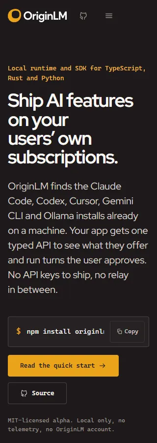 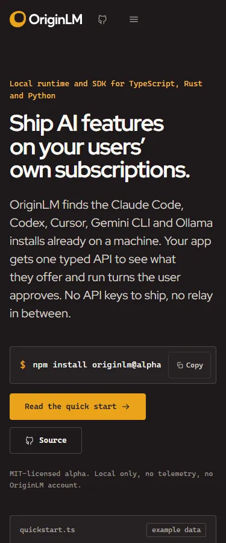
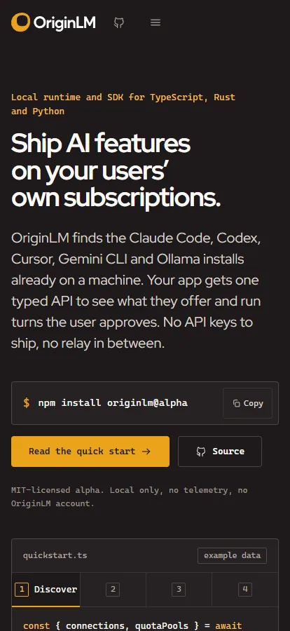 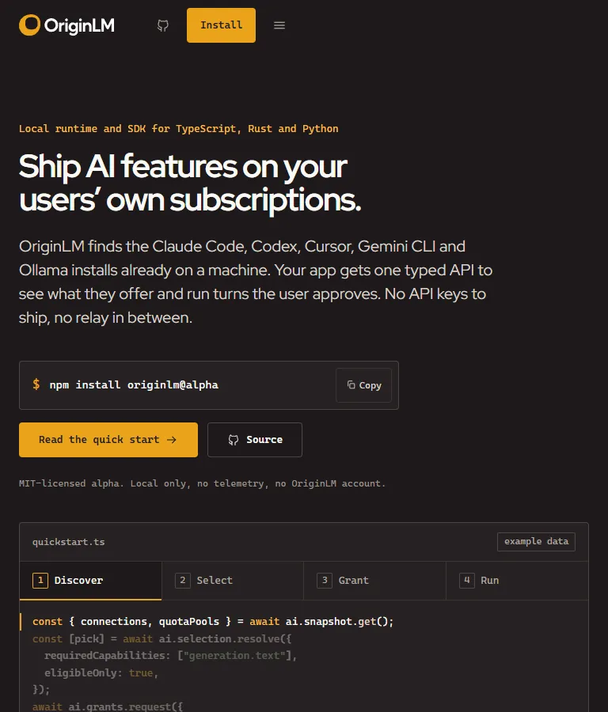
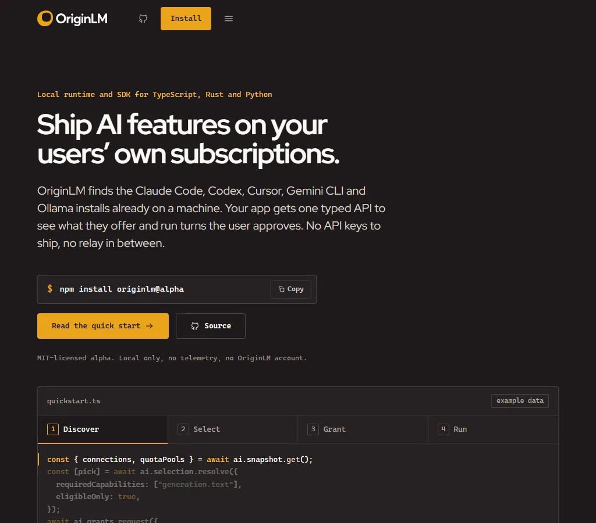 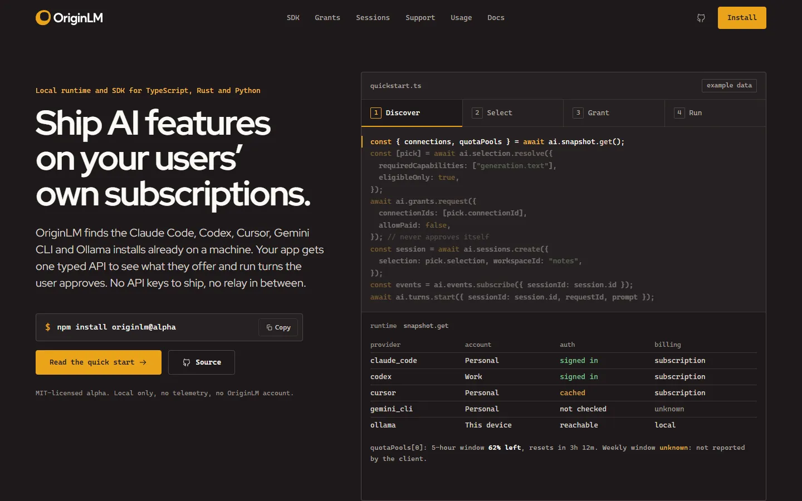
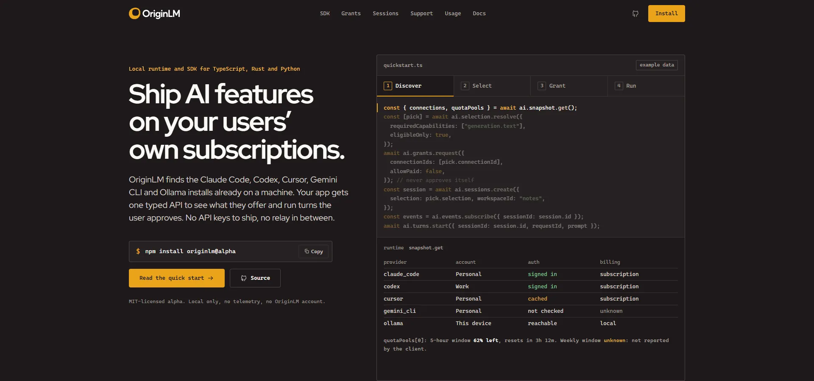; full page at 1440 (half scale)
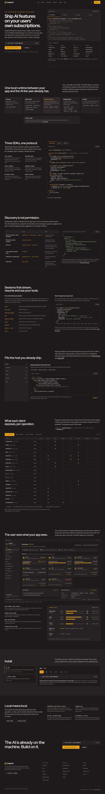 and 375
; hero grant and run states
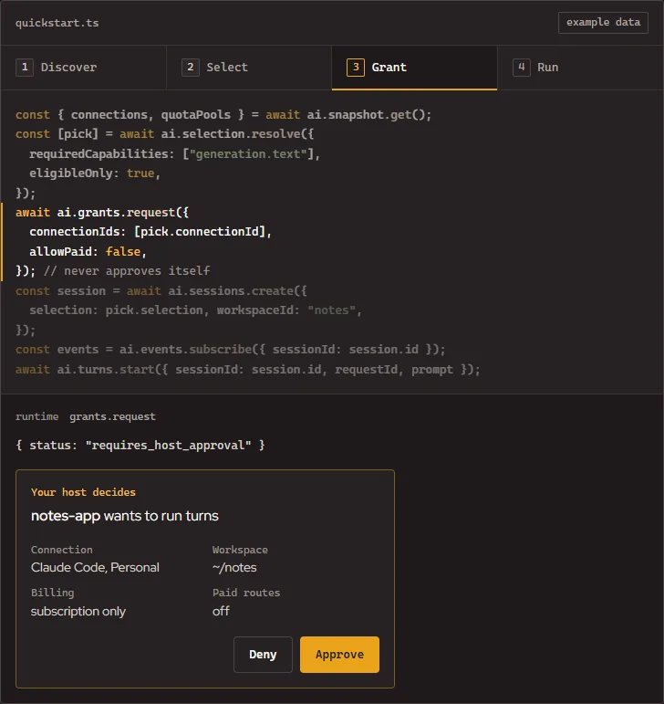
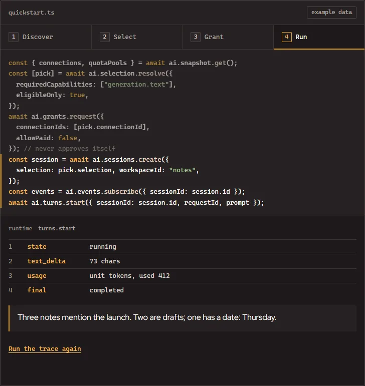; diagram and control center
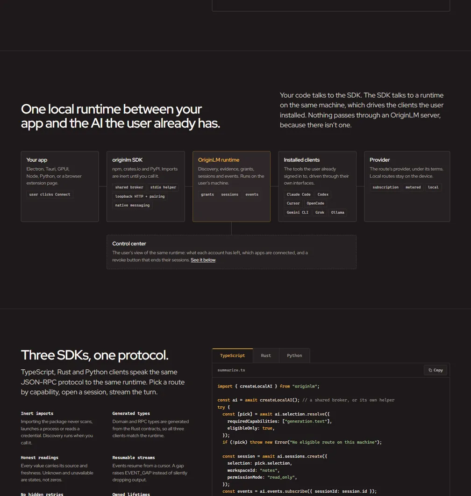
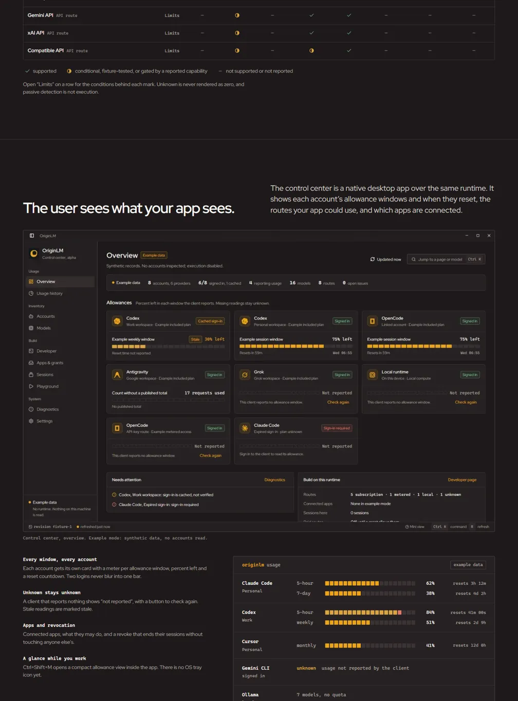. Before:
[`screens/site/before/`](screens/site/before/).

## Verification log

| Check | Result |
|---|---|
| `npm run build` in `apps/site` | OK. JS 91.9 KB gzip (app 23.4, React 68.5), CSS 8.4 KB gzip, font 40.8 KB, prerendered HTML 22.7 KB gzip |
| `node --test scripts/test_site.mjs` against `vite preview` | 8 of 8 pass: overflow, page errors, 44/32px targets and one-line labels at 320, 375, 414, 768, 1024, 1440, 1920; no-JS prerender; landmarks, headings, skip link, metadata, JSON-LD, manifest, sitemap, robots; trace autoplay, pause, fixed height, approve, deny; reduced motion and keyboard; SDK tabs; mobile menu; every anchor below the sticky nav |
| Sample compilation | TypeScript 7/7, Python 3/3, Rust 4/4, JSON 1/1 (see H1) |
| Contrast | 46/46 site pairs pass |
| Lab performance | See Motion |
| Screenshots | 7 widths full-page and fold, hero states, sections; opened and inspected. Found and fixed: four-line headline at 1920, dead space in the fixed-height code area, trace height changing between steps |
| `python scripts/verify.py --profile core` | OK (workspace tests, 719 passed); no site-specific profile exists in `verify.py` |
| `python scripts/generate_brand_tokens.py --check` | OK |

### Not verified

- Real devices, Safari and Firefox (Chromium only).
- Screen reader output (structure and ARIA checked by tests and reading the DOM).
- Field performance (only local lab runs).
- Deployment: `originlm.dev` is a placeholder.

## Decision log

- 2026-11-04: Kept the terminal register and made it the only stylesheet.
- 2026-11-04: The hero is the trace, not a meter panel and not 3D. It is the only option that shows the differentiator (permission before execution) and real method names at once.
- 2026-11-04: The approval card in the trace stays an illustration labelled as the host's UI (default decision 1). The desktop app has a real revoke surface but no approval surface; hosts approve through a grants manifest or `Broker::authorize`, and the Grants section says so.
- 2026-11-04: Usage moved to section 8 and is framed as "the user sees what your app sees", with a real capture of the finished desktop app.
- 2026-11-04 (second pass): Deleted the unused scene, posters, screenshots, capture script and `three` (default decision 2). Revisiting 3D means restoring them from history.
- 2026-11-04 (second pass): No film (see Film).
- 2026-11-04 (second pass): All trace states share fixed grid cells so autoplay can never shift layout; chose that over a `min-height` guess, which had drifted out of date.
- 2026-11-04 (second pass): The code area shows the whole quickstart with the current call highlighted, instead of one call in a mostly empty box.
- 2026-11-04 (second pass): Autoplay stops before Approve and pauses on hover and focus (WCAG 2.2.2).
- 2026-11-04 (second pass): Mono is a declared second family, not an "outlier", for a developer tool.
- 2026-11-04 (second pass): Did not move npm's `latest` tag or publish anything (default decision 3); install copy says `@alpha` and pins elsewhere.
